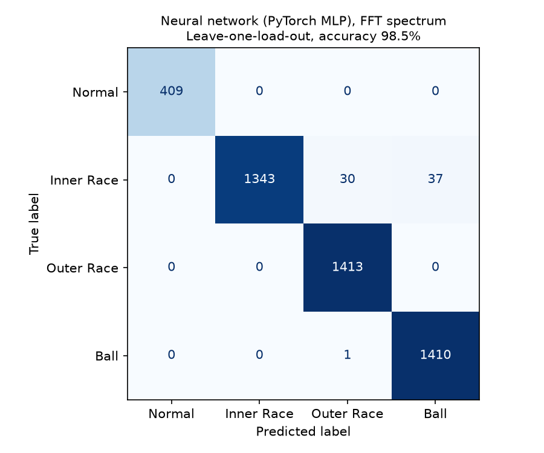

# Bearing Fault Classification (CWRU vibration data)

Classifies motor bearing condition (normal, inner-race fault, outer-race fault,
ball fault) from drive-end accelerometer signals in the Case Western Reserve
University (CWRU) bearing dataset.

This repo is a clean rebuild of a Jan to May 2026 project, which itself extended
a course project. The original notebook used logistic regression on four
hand-made features. This rebuild keeps that model as a baseline, adds logistic
regression on the FFT spectrum, and adds a PyTorch neural network.
The neural network is new work in this rebuild.

## Data

Source: [CWRU Bearing Data Center](https://engineering.case.edu/bearingdatacenter)
(Normal Baseline and 12k Drive End Bearing Fault pages). 40 recordings, about 140 MB:

| Class | Fault diameters (in) | Files |
|---|---|---|
| Normal | none | 97-100 |
| Inner race | 0.007, 0.014, 0.021 | 105-108, 169-172, 209-212 |
| Outer race (6:00) | 0.007, 0.014, 0.021 | 130-133, 197-200, 234-237 |
| Ball | 0.007, 0.014, 0.021 | 118-121, 185-188, 222-225 |

Each group of four files covers motor loads 0, 1, 2 and 3 HP.
The raw files go in `data/raw/` and are not tracked by git.

## Preprocessing

1. Read the drive-end signal whose variable name matches the file number
   (for example `X099_DE_time`). `99.mat` also contains `X098_DE_time`, so
   taking the first matching key would load the wrong recording.
2. Resample normal recordings from 48 kHz to 12 kHz so all classes share one
   sampling rate. Otherwise a model could learn the sampling rate instead of
   the fault. `src/check_sampling_rate.py` checks the rates from the data.
3. Cut each signal into 2048-sample windows (0.17 s) with a 1024-sample hop.
4. Spectrum features: z-score each window, apply a Hann taper, take the
   one-sided FFT magnitude, drop the DC bin, and take `log(1 + magnitude)`.
   This gives 1024 frequency bins from 5.9 Hz to 6 kHz.
5. Hand-made features (original notebook): RMS, kurtosis, FFT peak
   frequency and spectral entropy of the raw window.
6. Features are standardized with statistics from the training fold only.

## Models

- Logistic regression (scikit-learn), 4 hand-made features. Baseline from the original notebook.
- Logistic regression (scikit-learn), 1024 FFT bins.
- Neural network (PyTorch MLP), 1024 FFT bins: 1024 -> 256 -> 64 -> 4, ReLU,
  dropout 0.3, Adam (learning rate 1e-3, weight decay 1e-4), 40 epochs, batch 128.

Why this network: the input is a fixed-length list of 1024 numbers (the
spectrum), not an image or a time series, so a plain fully connected network
(multilayer perceptron) is the simplest network that fits. Logistic regression
can only draw straight-line boundaries between classes. The two hidden layers
let the network combine frequency bands in nonlinear ways, for example "energy
near band A and also near band B". The layers shrink from 1024 to 256 to 64 to 4
so the network compresses the spectrum into a few useful patterns before choosing
a class. Dropout randomly switches off 30% of the hidden units during training,
and weight decay keeps the weights small. Both reduce overfitting, which matters
because there are only 40 recordings. The model is small enough to train on a
CPU in seconds. Training runs for a fixed 40 epochs with no early stopping,
because early stopping on the test fold would leak test information.

All models use class-balanced weights, because there are 4 normal recordings
and 12 of each fault type. Hyperparameters were set before looking at test
results and were not tuned. Random seeds are fixed (42).

## Evaluation

No random split of windows is used. Neighboring windows from one recording
overlap, so a random split puts nearly the same data in train and test.

Main split: **leave-one-load-out**, 4 folds. Each fold trains on three motor
loads and tests on the fourth. Windows from a test recording are never seen in
training, and every window is tested once.

Stricter check: **leave-one-fault-size-and-load-out**, 12 folds. In CWRU, each
fault size is one damaged bearing run at all four loads, so the main split
still trains on the same damaged bearing at other loads. Here a fold tests one
fault size at one load (plus the normal recording at that load) and trains only
on the other two sizes at the other three loads. Normal recordings are tested
once per fault size, so they count three times in the pooled numbers.

Accuracy and macro F1 are computed on predictions pooled across all folds.
The worst fold is also shown.

## Results

All numbers below are measured by `src/run_experiment.py` with the fixed
settings above. Rerunning gives the same numbers. 4643 windows from 40
recordings (Normal 409, Inner race 1410, Outer race 1413, Ball 1411).

### Leave-one-load-out (main result)

| Model | Accuracy | Macro F1 | Worst-fold accuracy |
|---|---|---|---|
| Logistic regression, 4 hand-made features | 72.5% | 0.767 | 61.7% (0 HP) |
| Logistic regression, FFT spectrum | 98.5% | 0.987 | 95.5% (0 HP) |
| Neural network (PyTorch MLP), FFT spectrum | 98.5% | 0.988 | 96.3% (0 HP) |

Confusion matrices, side by side (rows = true class, columns = predicted):

| True \ Predicted | LR: Normal | LR: Inner | LR: Outer | LR: Ball | NN: Normal | NN: Inner | NN: Outer | NN: Ball |
|---|---|---|---|---|---|---|---|---|
| Normal | 409 | 0 | 0 | 0 | 409 | 0 | 0 | 0 |
| Inner race | 0 | 1345 | 16 | 49 | 0 | 1343 | 30 | 37 |
| Outer race | 3 | 0 | 1410 | 0 | 0 | 0 | 1413 | 0 |
| Ball | 0 | 0 | 0 | 1411 | 0 | 0 | 1 | 1410 |

LR = logistic regression on the FFT spectrum, NN = neural network on the FFT spectrum.




### Leave-one-fault-size-and-load-out (stricter)

| Model | Accuracy | Macro F1 | Worst-fold accuracy |
|---|---|---|---|
| Logistic regression, 4 hand-made features | 51.8% | 0.508 | 16.6% |
| Logistic regression, FFT spectrum | 57.6% | 0.524 | 42.0% |
| Neural network (PyTorch MLP), FFT spectrum | 56.7% | 0.521 | 42.0% |

Per-fold numbers and all confusion matrices are in [results/results.md](results/results.md).

### What the results show

- The FFT spectrum works much better than the four hand-made features
  (98.5% vs 72.5% on unseen loads).
- Logistic regression and the neural network perform about the same here.
  The extra model capacity did not help.
- **The score depends strongly on the split.** It is about 98% when the test
  load is new but the damaged bearing was seen in training. It drops to about
  57% when the damaged bearing is also new. In the stricter split, ball faults
  are still recognized well, but inner-race and outer-race faults are often
  confused with each other, and some outer-race windows are called normal.
- The original notebook reported 100% from a random 80/20 split of overlapping
  windows. That number is not valid, because near-duplicate windows from the
  same recording were in both train and test.

### Limitations

- Drive-end accelerometer only, 12 kHz data, outer-race faults at 6:00 only.
- One damaged bearing per fault type and size, so there are few independent
  examples of each fault.
- Each model is trained once with one seed. Variation across seeds was not measured.
- Hyperparameters were not tuned. Tuning would need a separate validation split.

## Notes on the data

- `99.mat` contains both `X098_DE_time` and `X099_DE_time`. The loader reads
  the variable that matches the file number.
- The normal recordings are sampled at 48 kHz and the fault recordings at
  12 kHz. Published sources disagree on the normal rate, so
  `src/check_sampling_rate.py` checks it from the data. Read at 48 kHz, the
  normal files show lines at exactly 1x, 2x and 3x shaft speed at all four
  motor speeds. Read at 12 kHz, these would be unphysical 0.25x, 0.5x and 0.75x
  lines. The 12 kHz fault files pass the same test only at 12 kHz.
  At 48 kHz, normal files 98-100 are 10.1 s long, the same length as the
  fault recordings at 12 kHz (97 is half as long).

## How to run

From PowerShell in the project folder:

```powershell
python -m venv .venv
.\.venv\Scripts\python.exe -m pip install torch --index-url https://download.pytorch.org/whl/cpu
.\.venv\Scripts\python.exe -m pip install -r requirements.txt
.\.venv\Scripts\python.exe src\download_data.py
.\.venv\Scripts\python.exe src\check_sampling_rate.py
.\.venv\Scripts\python.exe src\run_experiment.py
```

Results are written to `results/` (`metrics.json`, `results.md` and confusion matrix PNGs).

## Project layout

```
src/cwru_files.py           list of recordings, labels, loads, sampling rates
src/download_data.py        downloads the .mat files into data/raw
src/check_sampling_rate.py  checks recording sampling rates from the data
src/load_data.py            reads, resamples and windows the signals
src/features.py             normalization, FFT spectrum, hand-made features
src/models.py               logistic regression and PyTorch network
src/run_experiment.py       cross-validation, metrics, plots
```
